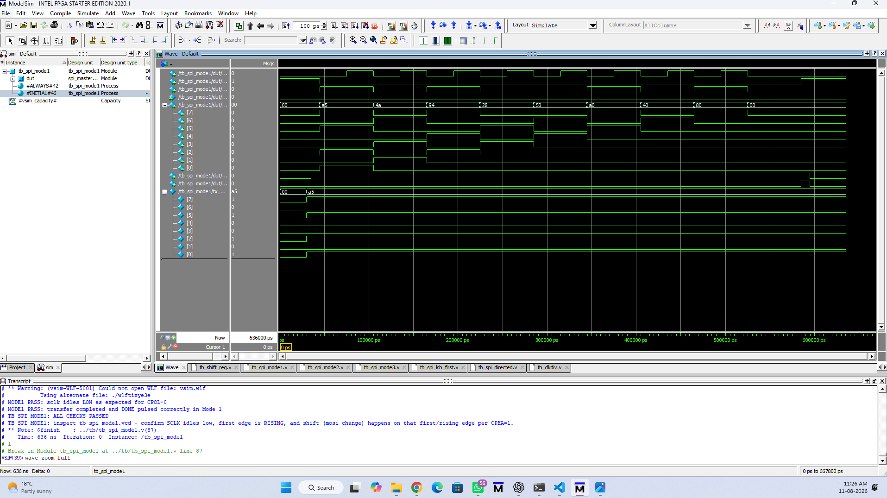
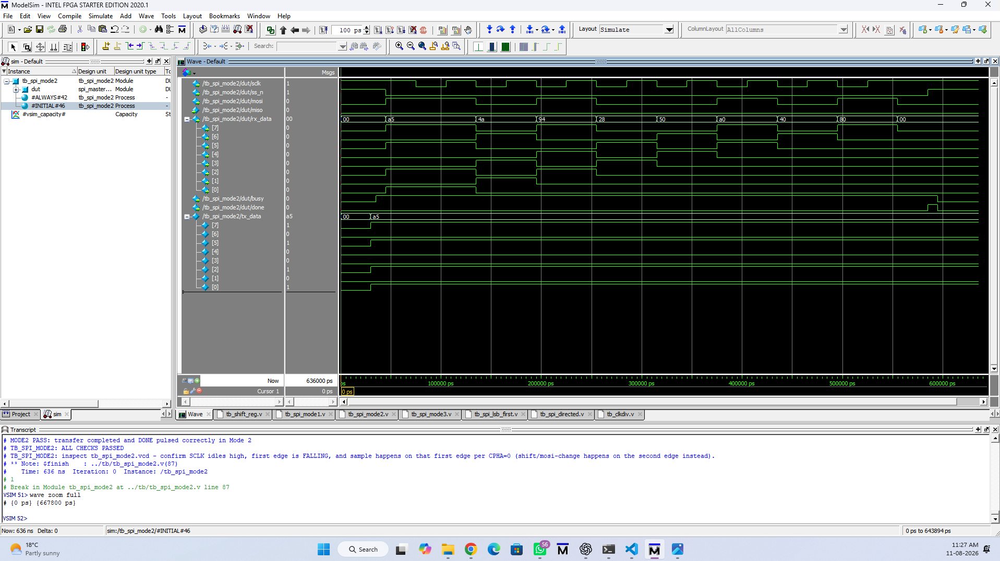
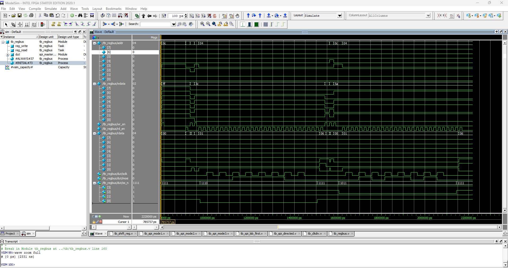

# SPI Master Controller (Self-Initiated Project)

A configurable SPI Master controller written in Verilog, designed and verified
in Icarus Verilog / GTKWave (ModelSim/QuestaSim compatible).

## Status
**Phase 1 + Phase 2: complete.** All 4 SPI modes, register bus interface
(with ENABLE gating and multi-slave SS_SEL), bit-accurate MISO capture, and
LSB-first ordering are all implemented and verified with passing directed
tests. A real off-by-one bug was found and fixed along the way (see "Bugs
found and fixed" below).

**Deliberately out of scope:** a self-checking randomized-transaction
scoreboard and a UVM testbench were not built. Those are
verification-methodology exercises; this project is scoped toward
demonstrating RTL design and directed verification skills for a
design-track role, not a verification-engineering deep-dive.

## What's implemented
- `spi_clkdiv.v` — programmable clock divider, generates SCLK timing pulses
- `spi_shift_reg.v` — 8-bit shift register, supports MSB-first and LSB-first
- `spi_ctrl_fsm.v` — control FSM sequencing a full SPI transfer, generalized
  for all 4 SPI modes: CPOL sets idle/active clock levels, CPHA selects
  which of the two edges per bit is the shift edge (see comments in the
  file for the reasoning)
- `spi_master_top.v` — pin-level top integration (direct cpol/cpha/tx_data pins)
- `spi_regfile.v` — register bus interface: CTRL/STATUS/CLKDIV/TX_DATA/RX_DATA/SS_SEL
- `spi_master_regbus_top.v` — **recommended top-level module.** Host-facing
  integration, wraps `spi_master_top.v` behind the register bus so a
  CPU/testbench configures and drives the core entirely through register
  writes/reads, matching the spec's register map. Includes ENABLE gating
  and multi-slave SS_n decode.

## Verification so far
| Test | Description                          | Status |
|------|---------------------------------------|--------|
| T1   | Reset behavior                        | PASS   |
| T2   | Mode 0 basic MOSI transfer            | PASS   |
| —    | Mode 1 (CPOL=0, CPHA=1)               | PASS   |
| —    | Mode 2 (CPOL=1, CPHA=0)               | PASS   |
| T3   | Mode 3 (CPOL=1, CPHA=1)               | PASS   |
| T4   | MISO capture into rx_data             | PASS — bit-accurate MISO drive, rx_data exactly matches driven pattern |
| T5   | Clock divider frequency check         | PASS (standalone, see `tb_clkdiv.v`) |
| T6   | Slave-select line selection           | PASS — see "Register bus: SS_SEL" row below |
| T7   | LSB-first vs MSB-first                | PASS — verified at top level with non-symmetric byte |
| T8   | BUSY/DONE flag timing                 | Verified via T1/T2/T3/Mode1/Mode2 |
| —    | Register bus: CTRL write/readback     | PASS   |
| —    | Register bus: CLKDIV write            | PASS   |
| —    | Register bus: TX_DATA write triggers transfer | PASS |
| —    | Register bus: STATUS polling for DONE | PASS   |
| —    | Register bus: STATUS.DONE clear-on-write | PASS |
| —    | SS_SEL bus (multi-slave decode)       | PASS — verified only selected slave's ss_n line asserts |
| —    | CTRL.ENABLE gating                    | PASS — confirmed no transfer while disabled, resumes correctly when re-enabled |

Each RTL block also has its own standalone testbench (`tb_clkdiv.v`,
`tb_shift_reg.v`) confirming correct behavior in isolation before integration
— this made debugging the top-level FSM much easier.

## Waveforms

**Mode 0 (CPOL=0, CPHA=0) — basic transfer with bit-accurate MISO capture:**


**Mode 1 (CPOL=0, CPHA=1) — shift happens on the first/rising edge:**


**Mode 2 (CPOL=1, CPHA=0) — SCLK idles high, first edge falling:**


**Mode 3 (CPOL=1, CPHA=1) — SCLK idles high, shift on first/falling edge:**


**Register bus — full host-driven flow (CTRL/CLKDIV config → TX_DATA write → STATUS poll → RX_DATA read, plus ENABLE gating and SS_SEL multi-slave decode):**


## How to run the simulations

### Option A: ModelSim / QuestaSim (recommended)

From a terminal, inside the `sim/` directory:

```bash
vsim -do run_all.do
```

Or from within the ModelSim GUI console:

```tcl
cd sim
do run_all.do
```

This compiles all RTL + testbenches, runs the standalone and mode/regbus
tests in the console, then opens `tb_spi_directed` in the Wave window with
SCLK, SS_n, MOSI, MISO, rx_data, busy, and done already added — compare this
against the timing diagram in `docs/spi_master_spec.md` section 5.

### Option B: Icarus Verilog (free, no license needed)

```bash
# Standalone module tests
iverilog -o sim/tb_clkdiv.vvp rtl/spi_clkdiv.v tb/tb_clkdiv.v
vvp sim/tb_clkdiv.vvp

iverilog -o sim/tb_shift_reg.vvp rtl/spi_shift_reg.v tb/tb_shift_reg.v
vvp sim/tb_shift_reg.vvp

# Top-level directed test (Mode 0, T1/T2/T4)
iverilog -o sim/tb_spi_directed.vvp rtl/spi_clkdiv.v rtl/spi_shift_reg.v \
    rtl/spi_ctrl_fsm.v rtl/spi_master_top.v tb/tb_spi_directed.v
vvp sim/tb_spi_directed.vvp

# Mode 1, 2, 3 tests
iverilog -o sim/tb_spi_mode1.vvp rtl/spi_clkdiv.v rtl/spi_shift_reg.v \
    rtl/spi_ctrl_fsm.v rtl/spi_master_top.v tb/tb_spi_mode1.v
vvp sim/tb_spi_mode1.vvp

iverilog -o sim/tb_spi_mode2.vvp rtl/spi_clkdiv.v rtl/spi_shift_reg.v \
    rtl/spi_ctrl_fsm.v rtl/spi_master_top.v tb/tb_spi_mode2.v
vvp sim/tb_spi_mode2.vvp

iverilog -o sim/tb_spi_mode3.vvp rtl/spi_clkdiv.v rtl/spi_shift_reg.v \
    rtl/spi_ctrl_fsm.v rtl/spi_master_top.v tb/tb_spi_mode3.v
vvp sim/tb_spi_mode3.vvp

# LSB-first test
iverilog -o sim/tb_spi_lsb_first.vvp rtl/spi_clkdiv.v rtl/spi_shift_reg.v \
    rtl/spi_ctrl_fsm.v rtl/spi_master_top.v tb/tb_spi_lsb_first.v
vvp sim/tb_spi_lsb_first.vvp

# Register bus test
iverilog -o sim/tb_regbus.vvp rtl/spi_clkdiv.v rtl/spi_shift_reg.v \
    rtl/spi_ctrl_fsm.v rtl/spi_master_top.v rtl/spi_regfile.v \
    rtl/spi_master_regbus_top.v tb/tb_regbus.v
vvp sim/tb_regbus.vvp

# View waveforms (after running the sim above, .vcd files land in sim/waves/)
gtkwave sim/waves/tb_spi_directed.vcd
```

## Design spec
Full register map, timing diagrams, and verification plan: see
[`docs/spi_master_spec.md`](docs/spi_master_spec.md).

## Bugs found and fixed
- **Off-by-one in bit counter termination (found via T4):** the FSM's
  next-state logic checked `bit_count == 8` to detect the last bit of a
  byte transfer, but `bit_count` is pre-increment (counts 0..7 across the
  8 bit periods), so the check should have been `bit_count == 7`. This
  caused a spurious 9th shift/capture on every transfer, silently
  corrupting `rx_data`. It went undetected through Phase 1 because the
  original T4 check was only informational (no bit-accurate MISO drive to
  compare against). Fixed in `spi_ctrl_fsm.v` once T4 was made a real
  pass/fail check — a good example of why "informational" tests should
  be upgraded to real assertions as soon as possible.

## Why this project
Built to develop hands-on RTL design and verification skills for embedded
protocol IP, extending prior digital design work (RISC-V core) into a
smaller, complete, spec-to-verified-silicon-style deliverable.
