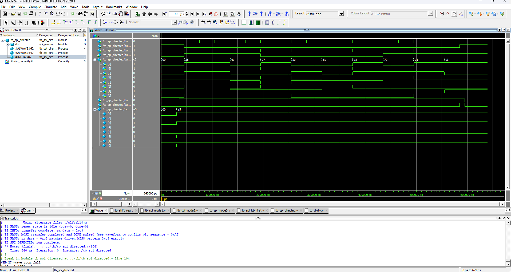
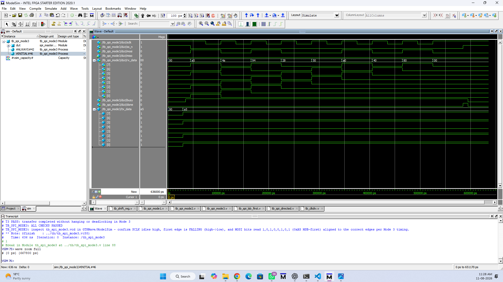

# SPI Master Controller (Verilog)

A configurable SPI master controller in Verilog with all four SPI modes, MSB-first and LSB-first transfers, a register-bus host interface and multi-slave select. Designed and verified with directed testbenches in Icarus Verilog / GTKWave (ModelSim/QuestaSim compatible).

## Features

- All four SPI modes (CPOL/CPHA = 00, 01, 10, 11)
- 8-bit transfers, MSB-first or LSB-first
- Programmable SCLK divider
- Register-bus host interface: CTRL, STATUS, CLKDIV, TX_DATA, RX_DATA, SS_SEL
- Multi-slave select decode (SS_SEL drives the selected `ss_n` line only)
- ENABLE gating: no transfer starts while disabled
- Bit-accurate MISO capture into RX_DATA

## Architecture

```
                     spi_master_regbus_top  (recommended top level)
   ┌─────────────────────────────────────────────────────────────────┐
   │                                                                 │
   │  host      ┌──────────────┐        ┌───────────────────────────┐│
   │  register  │  spi_regfile │        │      spi_master_top       ││
   │  bus  ────►│ CTRL  STATUS │ cpol,  │ ┌──────────┐ ┌──────────┐ ││──► sclk
   │            │ CLKDIV TX_DATA─cpha,──►│ │spi_ctrl_ │ │spi_clkdiv│ ││──► mosi
   │  ◄────     │ RX_DATA SS_SEL│ tx_data│ │  fsm     │ └──────────┘ ││◄── miso
   │            └──────────────┘        │ └────┬─────┘ ┌──────────┐ ││──► ss_n[]
   │                   ▲   busy, done,   │      └──────►│spi_shift_│ ││
   │                   └── rx_data ◄─────│              │  reg     │ ││
   │                                     │              └──────────┘ ││
   │                                     └───────────────────────────┘│
   └─────────────────────────────────────────────────────────────────┘
```

| File | Role |
|---|---|
| `rtl/spi_clkdiv.v` | Programmable clock divider; generates SCLK timing pulses |
| `rtl/spi_shift_reg.v` | 8-bit shift register, MSB-first or LSB-first |
| `rtl/spi_ctrl_fsm.v` | Control FSM that sequences a full transfer. CPOL sets the idle and active clock levels, CPHA selects which of the two edges per bit is the shift edge (see comments in the file) |
| `rtl/spi_master_top.v` | Pin-level top: direct `cpol`, `cpha` and `tx_data` pins |
| `rtl/spi_regfile.v` | Register bus interface |
| `rtl/spi_master_regbus_top.v` | **Recommended top level.** Wraps `spi_master_top.v` behind the register bus, with ENABLE gating and SS_n decode |

## Registers

| Register | Purpose |
|---|---|
| `CTRL` | Enable and transfer configuration |
| `STATUS` | Busy and done flags; DONE is cleared by a write |
| `CLKDIV` | SCLK divider value |
| `TX_DATA` | Byte to send; writing it starts a transfer |
| `RX_DATA` | Byte received on MISO |
| `SS_SEL` | Selects which slave-select line is asserted |

Addresses and bit fields are in [`docs/spi_master_spec.md`](docs/spi_master_spec.md).

## Verification

Directed, self-checking testbenches. Each RTL block also has its own standalone testbench (`tb_clkdiv.v`, `tb_shift_reg.v`), which made debugging the top-level FSM much easier.

| Test | What it checks | Status |
|---|---|---|
| T1 | Reset behavior | PASS |
| T2 | Mode 0 basic MOSI transfer | PASS |
| - | Mode 1 (CPOL=0, CPHA=1) | PASS |
| - | Mode 2 (CPOL=1, CPHA=0) | PASS |
| T3 | Mode 3 (CPOL=1, CPHA=1) | PASS |
| T4 | MISO capture: RX_DATA matches the driven bit pattern exactly | PASS |
| T5 | Clock divider frequency (standalone, `tb_clkdiv.v`) | PASS |
| T6 | Slave-select line selection | PASS |
| T7 | LSB-first vs MSB-first, using a non-symmetric byte | PASS |
| T8 | BUSY/DONE timing | Covered indirectly by T1, T2, T3, Mode 1 and Mode 2 (no dedicated test) |
| - | Register bus: CTRL write and readback | PASS |
| - | Register bus: CLKDIV write | PASS |
| - | Register bus: TX_DATA write triggers a transfer | PASS |
| - | Register bus: STATUS polling for DONE | PASS |
| - | Register bus: STATUS.DONE clear-on-write | PASS |
| - | SS_SEL decode: only the selected `ss_n` asserts | PASS |
| - | CTRL.ENABLE gating: no transfer while disabled, resumes when re-enabled | PASS |

The run log from the ModelSim script is in `sim/run_all.log`.

### Waveforms

**Mode 0 (CPOL=0, CPHA=0): basic transfer with bit-accurate MISO capture**


**Mode 1 (CPOL=0, CPHA=1): shift on the first (rising) edge**


**Mode 2 (CPOL=1, CPHA=0): SCLK idles high, first edge falling**


**Mode 3 (CPOL=1, CPHA=1): SCLK idles high, shift on the first (falling) edge**


**Register bus: CTRL/CLKDIV config, TX_DATA write, STATUS poll, RX_DATA read, ENABLE gating and SS_SEL decode**


## Bug found and fixed

**Off-by-one in the bit counter (found by making T4 a real pass/fail check).**
The FSM tested `bit_count == 8` to detect the last bit of a byte, but `bit_count` is pre-increment (it counts 0 to 7 over the 8 bit periods), so the check had to be `bit_count == 7`. The wrong value caused a spurious 9th shift and capture on every transfer and silently corrupted `rx_data`. It went unnoticed in Phase 1 because the original T4 check was only informational, with no bit-accurate MISO drive to compare against. Fixed in `spi_ctrl_fsm.v` once T4 compared `rx_data` against the driven pattern. The lesson: turn informational checks into real assertions as early as possible.

## How to run

### ModelSim / QuestaSim

From the `sim/` directory:

```bash
vsim -do run_all.do
```

or, inside the ModelSim console:

```tcl
cd sim
do run_all.do
```

This compiles all RTL and testbenches, runs the standalone, mode and register-bus tests in the console, and opens `tb_spi_directed` in the Wave window with SCLK, SS_n, MOSI, MISO, rx_data, busy and done already added. Compare it with the timing diagram in section 5 of `docs/spi_master_spec.md`.

### Icarus Verilog

```bash
# Standalone module tests
iverilog -o sim/tb_clkdiv.vvp rtl/spi_clkdiv.v tb/tb_clkdiv.v
vvp sim/tb_clkdiv.vvp

iverilog -o sim/tb_shift_reg.vvp rtl/spi_shift_reg.v tb/tb_shift_reg.v
vvp sim/tb_shift_reg.vvp

# Top-level directed test (Mode 0, T1/T2/T4)
iverilog -o sim/tb_spi_directed.vvp rtl/spi_clkdiv.v rtl/spi_shift_reg.v \
    rtl/spi_ctrl_fsm.v rtl/spi_master_top.v tb/tb_spi_directed.v
vvp sim/tb_spi_directed.vvp

# Modes 1, 2, 3
iverilog -o sim/tb_spi_mode1.vvp rtl/spi_clkdiv.v rtl/spi_shift_reg.v \
    rtl/spi_ctrl_fsm.v rtl/spi_master_top.v tb/tb_spi_mode1.v
vvp sim/tb_spi_mode1.vvp

iverilog -o sim/tb_spi_mode2.vvp rtl/spi_clkdiv.v rtl/spi_shift_reg.v \
    rtl/spi_ctrl_fsm.v rtl/spi_master_top.v tb/tb_spi_mode2.v
vvp sim/tb_spi_mode2.vvp

iverilog -o sim/tb_spi_mode3.vvp rtl/spi_clkdiv.v rtl/spi_shift_reg.v \
    rtl/spi_ctrl_fsm.v rtl/spi_master_top.v tb/tb_spi_mode3.v
vvp sim/tb_spi_mode3.vvp

# LSB-first
iverilog -o sim/tb_spi_lsb_first.vvp rtl/spi_clkdiv.v rtl/spi_shift_reg.v \
    rtl/spi_ctrl_fsm.v rtl/spi_master_top.v tb/tb_spi_lsb_first.v
vvp sim/tb_spi_lsb_first.vvp

# Register bus
iverilog -o sim/tb_regbus.vvp rtl/spi_clkdiv.v rtl/spi_shift_reg.v \
    rtl/spi_ctrl_fsm.v rtl/spi_master_top.v rtl/spi_regfile.v \
    rtl/spi_master_regbus_top.v tb/tb_regbus.v
vvp sim/tb_regbus.vvp

# View waveforms (after running the sims above, .vcd files land in sim/waves/)
gtkwave sim/waves/tb_spi_directed.vcd
```

## Scope and limitations

- Verification is **directed only**. A randomized scoreboard and a UVM testbench were left out on purpose: the project is scoped to RTL design and directed verification.
- Simulation only. The design has not been run on an FPGA or taken through a physical-design flow in this repository.
- BUSY/DONE timing has no dedicated test (see T8).
- 8-bit transfers only.

## Why this project

Built to practice protocol-IP RTL design: from a written spec (`docs/spi_master_spec.md`) to a verified, register-driven block, with every test checked against the spec.
